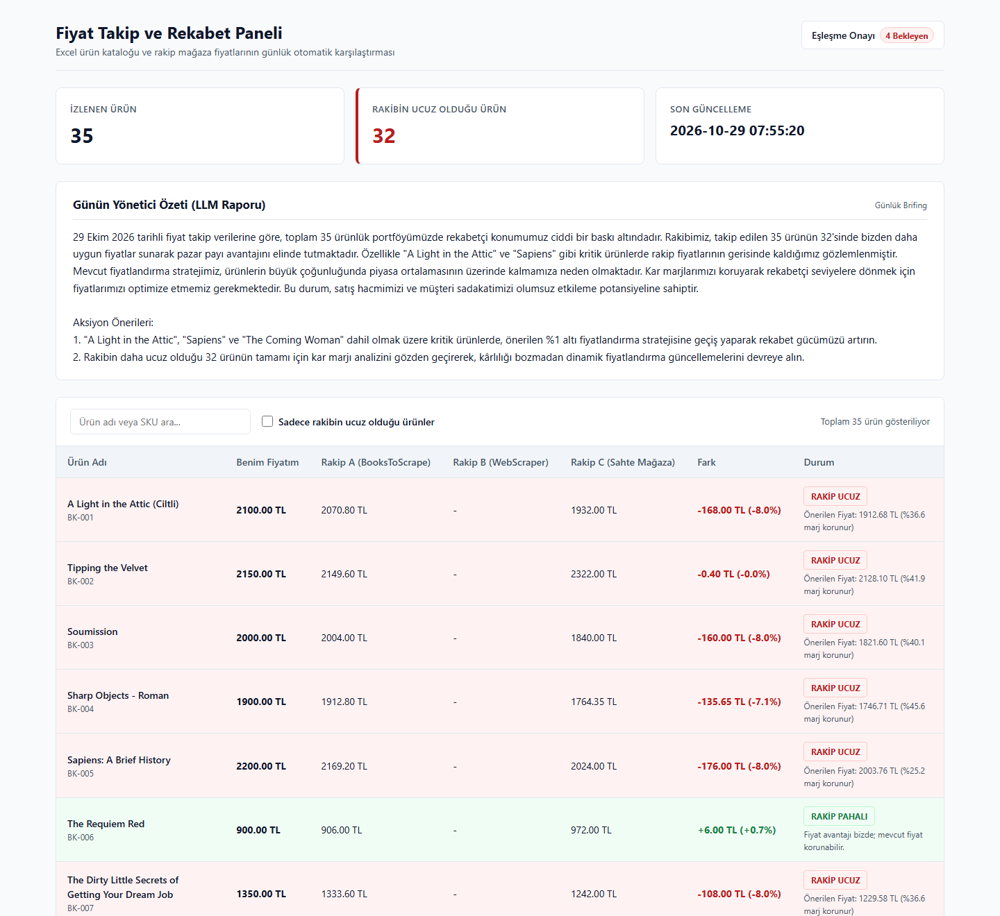
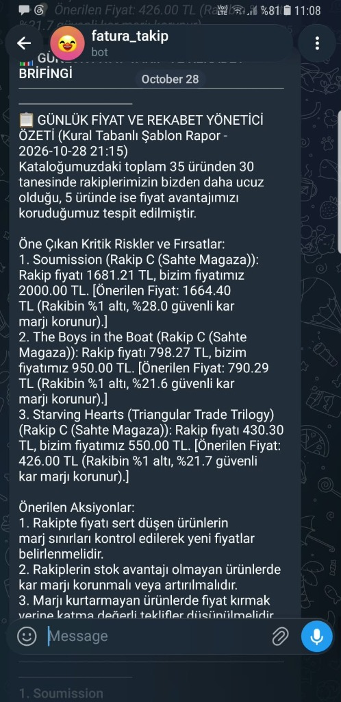
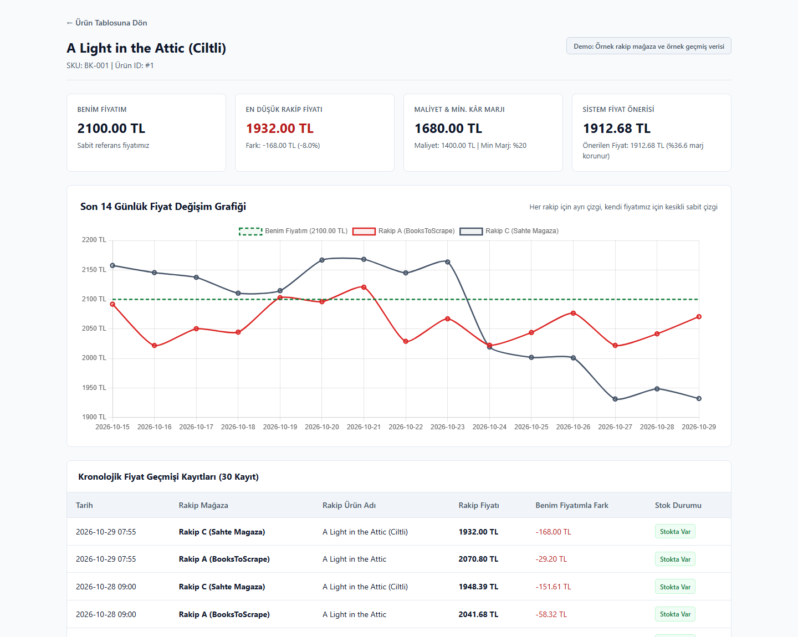
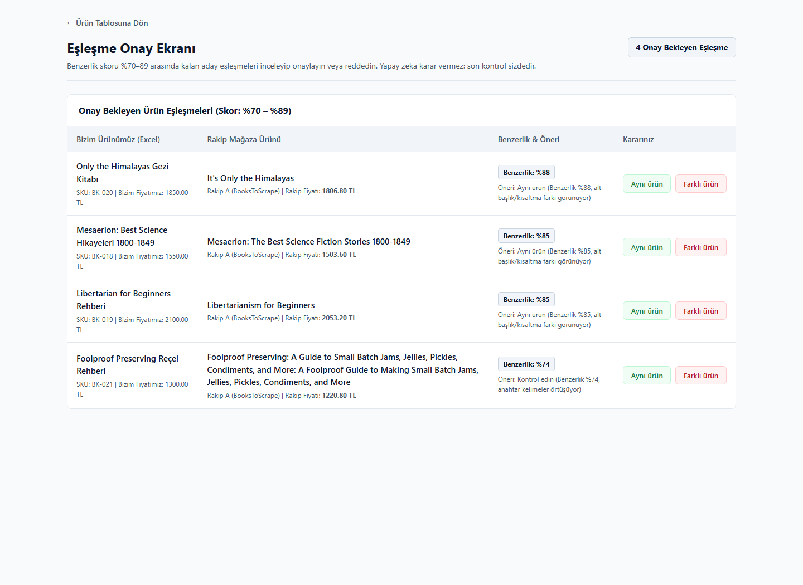
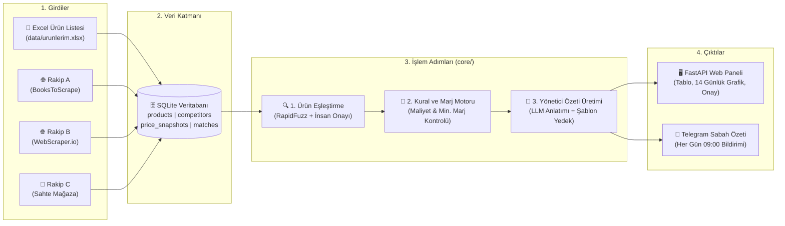

# 📊 Fiyat Takip ve Rekabet Analiz Sistemi

> **Excel'deki ürün listenizi rakip fiyatlarıyla her gün otomatik karşılaştıran ve sabah özetini Telegram'a gönderen sistem.**

---

## 🖥️ Ekran Görüntüleri (Web Paneli & Telegram Sabah Özeti)

### 1. Web Paneli — Ana Sayfa ve Ürün Karşılaştırma Tablosu
Kendi fiyatınız ile rakip mağaza fiyatlarını yan yana gösterir. Rakibin daha ucuz olduğu ürünleri **kırmızı**, fiyat avantajınızın olduğu ürünleri **yeşil** ile vurgular ve minimum kâr marjınızı koruyan yeni fiyat önerisini sunar.



### 2. Telefon Bildirimi — Telegram Sabah Özeti ve Kritik Uyarılar
Her sabah 09:00'da telefonunuza gelen özet mesajı; genel rekabet tablosunu, en acil aksiyon gerektiren ilk 3 ürünü ve kâr marjı korumalı fiyat önerilerini tek ekranda sunar.

| Günlük Yönetici Brifingi (Yapay Zeka Özeti) | Öne Çıkan Kritik Uyarılar ve Fiyat Önerileri |
| :---: | :---: |
|  |  |

### 3. Ürün Detay Sayfası — Son 14 Günlük Fiyat Değişim Grafiği
Bir ürüne tıkladığınızda kendi sabit fiyatınız (kesikli çizgi) karşısında tüm rakiplerin son 14 günlük fiyat hareketlerini ve geçmiş kayıt tablosunu incelersiniz.



### 4. Eşleşme Onay Ekranı — İnsan Onaylı Kontrol
Ürün isimleri farklı yazılmış olsa bile sistem benzerlik skorunu hesaplar. `%90` üzeri eşleşmeleri otomatik onaylar; `%70–89` arasındaki yakın adayları ise **"Aynı ürün"** veya **"Farklı ürün"** diyerek tek tıkla onaylamanız için size sunar.



---

## 🎯 Çözdüğü Sorun

E-ticaret yöneticileri ve işletme sahipleri her sabah onlarca rakip siteyi tek tek açıp fiyatları elle kontrol etmek için saatler harcar; üstelik gün içinde yapılan ani rakip indirimleri çoğu zaman fark edilmez. Bu sistem, kendi Excel ürün listenizi rakip mağazalarla her gün otomatik olarak karşılaştırır ve kâr marjınızı ezmeden hangi üründe ne kadar fiyat indirimi veya güncellemesi yapmanız gerektiğini hesaplar. Siz daha bilgisayarınızı açmadan, o günkü kritik fiyat değişimlerini ve aksiyon önerilerini hazır bir sabah özeti olarak telefonunuza gönderir.

---

## ⚙️ Nasıl Çalışır? (Mimari Şeması)

Sistem tek yönlü ve şeffaf bir akışla çalışır: girdiler veritabanına yazılır, çekirdek modüller (`core/`) veriyi işler, çıktılar ise web paneline ve Telegram'a iletilir. **Tüm matematiksel hesaplamalar ve marj kararları kod içinde yapılır; yapay zeka (LLM) yalnızca hesaplanmış sonuçları anlaşılır bir Türkçe ile özetler.**



| Katman | Modül / Dosya | Görevi |
| :--- | :--- | :--- |
| **Girdiler** | `core/load_excel.py`, `adapters/*` | Excel kataloğunu okur; rakip sitelerden güncel fiyat ve stok bilgisini çeker. |
| **Eşleştirme** | `core/matching.py` | İsim farklılıklarına rağmen (`token_set_ratio`) aynı ürünleri bulur ve eşleştirir. |
| **Kural Motoru** | `core/rules.py` | `RAKIP_UCUZ`, `FIYAT_DUSTU` (`>=%5`), `STOK_BITTI` kurallarını ve marj korumalı fiyat önerisini hesaplar. |
| **Raporlama** | `core/report.py` | Hesaplanan bulguları 1 paragraf yönetici özeti ve 2-3 maddelik aksiyon önerisine dönüştürür. |
| **Sunum & Uyarı** | `api/main.py`, `core/notify.py` | Web panelini sunar ve her sabah `09:00`'da (`scheduler.py`) Telegram brifingini gönderir. |

---

## 🚀 Kurulum (5 Komutta Çalıştırma)

Projeyi kendi bilgisayarınızda çalıştırmak için aşağıdaki **5 komutu** sırasıyla uygulayın:

```bash
# 1. Projeyi indirin ve klasöre girin
git clone https://github.com/kullaniciadi/fiyat-takip-sistemi.git && cd fiyat-takip-sistemi

# 2. Gerekli kütüphaneleri yükleyin
pip install -r requirements.txt

# 3. Ortam değişkenleri dosyasını oluşturun (isteğe bağlı Telegram ve API anahtarları için)
cp .env.example .env

# 4. Demo veritabanını hazırlayın ve günlük fiyat analizini çalıştırın
python scripts/demo_reset.py && python run_daily.py

# 5. Web panelini başlatın (Tarayıcıda: http://127.0.0.1:8000)
uvicorn api.main:app --port 8000
```

> **İpucu (Canlı Fiyat İndirimi Testi):** Sahte mağazayı `uvicorn fake_store.main:app --port 8001` ile açıp `python scripts/simulate_price_change.py` komutunu çalıştırarak bir rakibin ani fiyat düşüşünü ve sistemin ürettiği anlık Telegram uyarısını canlı test edebilirsiniz.

---

## 🛠️ Kullanılan Teknolojiler

- **Dil ve Çekirdek:** Python 3.11+
- **Web Paneli ve API:** FastAPI, Uvicorn, Jinja2
- **Veritabanı:** SQLite, SQLAlchemy 2.0
- **Veri Çekme (Scraping):** `httpx`, `BeautifulSoup4`, `lxml`
- **Veri İşleme ve Eşleştirme:** `openpyxl` (Excel), `rapidfuzz` (Bulanık metin eşleştirme)
- **Yapay Zeka (Özet Anlatımı):** Google Gemini API (`google-genai`), Groq API (Yedek LLM) ve kural tabanlı şablon yedek mekanizması
- **Bildirim ve Otomasyon:** Telegram Bot API, `APScheduler` (Günlük `09:00` zamanlayıcısı)
- **Görselleştirme:** Chart.js (14 günlük karşılaştırmalı fiyat geçmişi grafiği)

---

## ⚖️ Sınırlar ve Etik İlkeler

Bu proje geliştirilirken veri güvenliği, yasal sınırlar ve şeffaflık ilkelerine sıkı sıkıya bağlı kalınmıştır:

1. **Yalnızca Pratik ve Test Siteleri Kullanılmıştır:** Bu demo yalnızca veri çekmeye (scraping) açık eğitim/pratik siteleri (`books.toscrape.com`, `webscraper.io/test-sites/e-commerce/allinone`) ve proje içindeki yerel sahte mağaza (`fake_store`) ile çalışır. Büyük pazar yerleri veya kullanım koşulları veri çekmeye izin vermeyen ticari siteler **kesinlikle** kazınmamaktadır.
2. **Gerçek Projelerde `robots.txt` ve Resmi Veri Akışı:** Gerçek müşteri projelerinde hedef sitelerin `robots.txt` kurallarına ve kullanım koşullarına tam uyum sağlanır; istekler arasında bekleme süreleri uygulanır ve mümkün olan her durumda resmi veri akışları (API, XML/CSV ürün beslemeleri) tercih edilir.
3. **Örnek Demo Verisi (`örnek veri, örnek rakip`):** Bu repoda yer alan ürün kataloğu, rakip mağaza isimleri ve ürün detay sayfasındaki 14 günlük geçmiş fiyat grafikleri (`scripts/seed_history.py` ile üretilen kayıtlar) sunum amaçlı **örnek demo verisi**dir.

---

## 🔧 Gerçek Bir İşletme İçin Nasıl Uyarlanır?

Sistem, bir işletmenin kendi ürün kataloğuna ve takip etmek istediği rakip kaynaklara **1-2 gün içinde** uyarlanabilecek modüler bir yapıda tasarlanmıştır:

### 1. Kendi Ürün Listenizi Hazırlamak (`data/urunlerim.xlsx`)
Kendi Excel tablonuzu aşağıdaki 5 sütunla `data/urunlerim.xlsx` olarak kaydetmeniz yeterlidir:

| Sütun Adı | Açıklama | Örnek Değer |
| :--- | :--- | :--- |
| `sku` | Ürün stok kodu (benzersiz) | `BK-001` |
| `urun_adi` | Kendi mağazanızdaki ürün adı | `A Light in the Attic (Ciltli)` |
| `fiyat` | Güncel satış fiyatınız (TL) | `2100.00` |
| `maliyet` | Ürünün birim maliyeti (TL) | `1400.00` |
| `min_marj_yuzde` | Korunmasını istediğiniz en düşük kâr marjı (%) | `20` |

> Sistem fiyat önerisi yaparken `maliyet * (1 + min_marj_yuzde / 100)` formülüyle **dip fiyatınızı** hesaplar ve hiçbir zaman zarar edeceğiniz bir fiyat önermez.

### 2. Yeni Bir Rakip Adaptörü Eklemek (`adapters/`)
Sistem **"her siteye tek bir adaptör"** prensibiyle çalışır. Yeni bir rakip kaynağı (web sitesi, XML feed veya API) eklemek için `adapters/base.py` içindeki `BaseAdapter` sınıfından miras alan tek bir dosya oluşturmanız yeterlidir:

```python
from fiyat_takip_sistemi.adapters.base import BaseAdapter, RawProductListing

class YeniRakipAdapter(BaseAdapter):
    competitor_name = "Rakip D Mağazası"
    base_url = "https://ornek-rakip-magaza.com"

    def fetch_listings(self) -> list[RawProductListing]:
        # Yeni siteden veya XML/API kaynağından ürün adı, fiyat ve stok bilgisini döndürür.
        # Fiyat doğrulama, mükerrer kayıt engelleme ve veritabanı yazımı BaseAdapter tarafından otomatik yapılır.
        ...
```

---

## 📬 İletişim

Kendi ürün listenizi rakip fiyatlarıyla her gün otomatik karşılaştıran, kâr marjınızı koruyan ve sabah özetini telefonunuza gönderen bu sistemi **kendi mağazanız veya işletmeniz için kurmamı isterseniz** benimle iletişime geçebilirsiniz:

- **LinkedIn:** [LinkedIn Profilim](https://www.linkedin.com/)
- **E-posta:** `ozzencben@gmail.com`
- **GitHub:** [Proje Deposu](https://github.com/)
